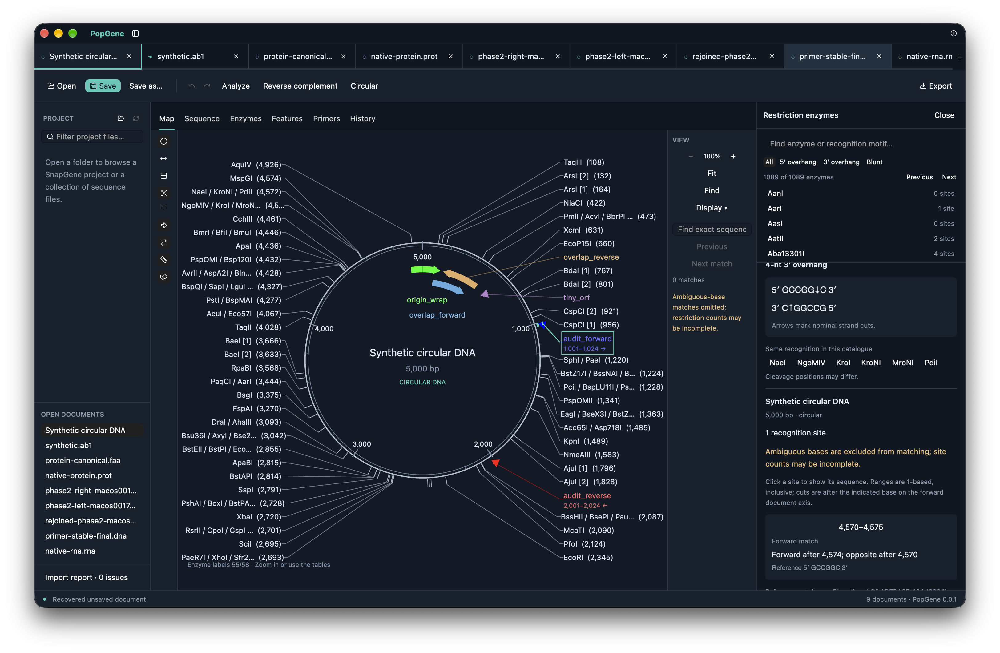

# PopGene

A native, offline sequence workbench built with Rust, GPUI and GPUI Kit. Licensed under [GPL-3.0-or-later](LICENSE).

PopGene opens synthetic example data on launch and works with local files without an account or network connection. Python is used only for developer tooling.



## Features

- Create DNA, RNA and protein documents; open multiple files or browse a project folder.
- Linked circular/linear maps and wrapped sequence views, with an adjustable split view. Thin left and right viewer sidebars hold filters, display options, zoom, search and range tools.
- Inspect features, primers, restriction sites, structured references, attachments, Sanger traces and protein properties. A full-duplex inspector shows physical strands and annotations that extend onto overhangs.
- Select bases and annotations, search sequences, edit DNA, reverse-complement and change topology, with per-document undo/redo.
- Read and write supported `.dna` / `.rna` / `.prot`, GenBank / GenPept, EMBL, FASTA, ABIF, SCF, ZTR and FASTQ data. Read legacy `.popgene` documents. Save and export show format-specific loss warnings.

Displayed coordinates are 1-based inclusive. The development catalogue contains 1,089 enzymes, including 755 with defined cleavage offsets. Translation supports 27 current NCBI genetic codes; frame and ORF analysis uses the selected code. Unknown cleavage positions and ambiguous calculations remain explicit.

PopGene is under active development. Unchanged same-format saves preserve source bytes; edited or converted saves preserve only the target codec's supported data. See [file formats and limitations](docs/file-formats.md).

## Implementation status and remaining work

Status updated 26 October 2026. The consolidated local build is available at `dist/PopGene.app`; see the [build notes](release/notes/0.0.1-consolidated.md). The frozen `source0017` checkpoint passed **443 tests on both macOS and Linux ARM64**, strict workspace lint, formatting and debug builds. Windows GNU test compilation, strict lint and app cross-linking passed. The final circular-RNA correction passed 172 formats tests, scoped strict lint/formatting and a byte-preserving probe. The optimized bundle was rebuilt, signature-checked and launched; the exact RNA file now opens with its annotation and zero import errors. The earlier full-platform checks were not rerun for this narrow correction. The checks below establish their stated coverage, not complete feature equivalence. See [release acceptance](docs/implementation-checklist.md).

Optimized download candidates for **macOS ARM64, Linux ARM64 and Windows x64** are prepared locally under `dist/release-candidates/`, alongside matching source archives, notices, build manifests and checksums. Linux requires glibc 2.39 or later and passed an optimized-app RNA smoke test. The Windows cross-build uses an isolated graphics-dependency portability patch included in its separate source archive; it has not run on Windows. These files are ignored build output, not committed binaries or published release assets. Notice review, macOS distribution signing/notarization and Windows runtime acceptance remain outstanding. See the [candidate package notes](release/notes/0.0.1-candidates.md).

| Area | Built and verified | Remaining or unsupported |
| --- | --- | --- |
| Translations | CDS/six-frame translation, 27 genetic codes, exceptions, partial locations, ORFs and CDS flanks. Linux GUI checks passed circular ORF navigation, copied protein, filtering and flank refresh. | Broader native comparison remains outside the verified cases. |
| Protein properties | Mass, Bjellqvist/EMBOSS/Grimsley charge and pI, selected residues, modifications, disulfides, extinction and labelled structure estimates. Independent calculations, Linux selection/edit checks and optimized macOS Grimsley UI acceptance passed; see [protein models](docs/protein-models.md). | Estimates do not establish measured structure or universal numerical equivalence. |
| Annotations and primers | Complex locations, segment colors/names, gap/line display, cleavage and between-base markers, full-duplex annotations; Primer3 design, reaction parameters, unbound oligos and editing. Linux design/edit/save/reopen retained coordinates, reaction metadata and generated colors. Stable fallback colors for uncolored primers passed regression tests and optimized macOS native UI acceptance. | Native line encoding and automatic application of stored visibility/active-panel settings remain unsupported. |
| Traces | ABIF/SCF/ZTR/FASTQ, instrument metadata, alternate calls, quality tracks, trimming, editing and alignment. Linux checks passed edge-label and nearest-peak selection behavior. | Broader native format/editing comparison remains pending; explicit precision and conversion limits still apply. |
| Restriction analysis | 1,089 enzymes, custom lists/count filters, cut pairs, unknown-cut reporting, recorded methylation assumptions, digestion and physical ends. Linux GUI checks passed lists, restoration, condition validation and unequal-strand save/reopen. | EcoKI sensitivity and partial/site-specific methylation are not modeled. Recorded whole-template flags are assumptions, not measured occupancy. |
| File compatibility | Native DNA/RNA/protein, multi-record input, references, attachments, embedded traces, bounded original-record inspection and supported history restoration. Linux save/reopen verified primer-packet settings, reverse-complemented cleavage markers and explicit stored-panel selection. Exact local ranges/joins on a uniform strand export natively. Circular RNA retains inactive terminal fields and unchanged source bytes; its final packaged-app import passed. | Native fuzzy/remote/mixed-strand and other unsupported location operators are refused. Unknown segment semantics block unsafe rewrites. Unsupported history operations remain uninterpreted; stored RNA structures and alignments are inspectable metadata. |
| Cloning and alignment | PCR, ligation, overlap, Golden Gate, pairwise/multiple alignment and consensus, with current-input result guards. Linux GUI and independent checks verified generated sequences, annotations, citations, colors, reaction metadata, ends and clipboard output. Bounded annotation ancestry supports proven reconstruction and readable persistence. | Reconstruction requires preserved identity and supported geometry; unpersisted seeds, edited/ambiguous ancestry and documented resource limits remain explicit. See [annotation lineage](docs/annotation-lineage.md). |
| Physical-fragment persistence | The documented [GenBank/EMBL extension](docs/physical-fragments.md) preserves actual opposite strands, ends, full-axis annotations, nullable qualities, colors and references. Codec, desktop Undo/Redo/recovery and macOS GUI Save/close/reopen/rejoin checks passed. The resulting native product reopened with one phase-2 CDS and **WNSS**, also verified in the reference application using that exact file. | The extension is PopGene metadata; other readers see the ordinary top-strand record. It does not provide native fuzzy-location encoding or arbitrary ancestry reconstruction. |
| Publication exports | Map/sequence SVG, PDF and PNG, pagination, layers, dimensions and bundled fonts. Linux PDF/PNG and chooser checks passed; macOS PDF export retained the reconstructed feature, ruler and enzyme labels. | Unsupported glyphs or incomplete text shaping produce explicit errors. |
| Recovery and dialogs | Linux unsaved-document/draft recovery and external-file conflict checks passed. macOS crash/relaunch restored the verified session and original bytes. Linux parented chooser cancellation, import/export and Save As/reopen passed. Optimized macOS checks passed Open cancellation/retry, multiple-file opening and saved-copy reopen after restarting the isolated test app. | An earlier intermittent invisible Open panel left editing disabled; its cause remains undetermined. |
| Platforms and delivery | `source0017`: 443 tests each on macOS/Linux, strict lint, formatting and debug links; Windows GNU tests/app cross-checks passed. Optimized macOS/Linux ARM64 and Windows x64 candidate packages are built, with source and notices. The exact Linux release executable passed a fresh-profile circular-RNA display and clean-exit check. | Linux requires glibc 2.39+. Windows uses a documented dependency patch and remains untested at runtime; MSVC verification is unavailable. Public distribution still requires notice review, macOS distribution signing/notarization and platform acceptance. |

Sequence construction does not predict experimental yield. Original bytes remain separately recoverable; unsupported records and conversion losses are reported. The intermittent Open-panel incident and unsupported capabilities remain documented; the successful retry does not establish its cause.

## Build

Install Rust **1.99.1** and your platform's C compiler and SDK, then run:

```sh
cargo run --locked --release -p popgene-desktop
cargo test --locked --workspace
cargo clippy --locked --workspace --all-targets -- -D warnings
cargo fmt --all --check
```

The native UI has been exercised on macOS and Linux ARM64 with the coverage recorded above. Windows GNU x86_64 tests and the app compile/link with strict lint, but have not run on Windows; runtime and MSVC verification are unavailable. The [CI workflow](.github/workflows/rust.yml) defines checks and Linux package prerequisites.

For local macOS packaging, run `scripts/package-macos.sh`. The bundle embeds Sparkle for **PopGene → Check for Updates…**; the first packaging run downloads a pinned, checksum-verified Sparkle distribution. Local builds are ad-hoc signed, not notarized. See [releasing and updates](docs/releases.md) for Developer ID signing, notarization, GitHub release drafts and the update feed. [Third-party notices](THIRD_PARTY.md) document unresolved dependency-notice provenance items that need review before public binary redistribution.

## Development

| Crate | Responsibility |
| --- | --- |
| `popgene-core` | Sequence model, coordinates, search, edits and undo |
| `popgene-formats` | File codecs, legacy import, folder inventory and atomic saves |
| `popgene-desktop` | Native workspace, linked views and background file I/O |

See [development and validation](docs/development.md) and [synthetic fixture provenance](validation/fixtures/README.md). Contributions should include focused tests for changed sequence or file semantics and preserve the licence notices in `vendor-notices/`.
